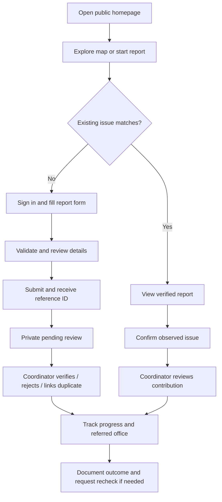
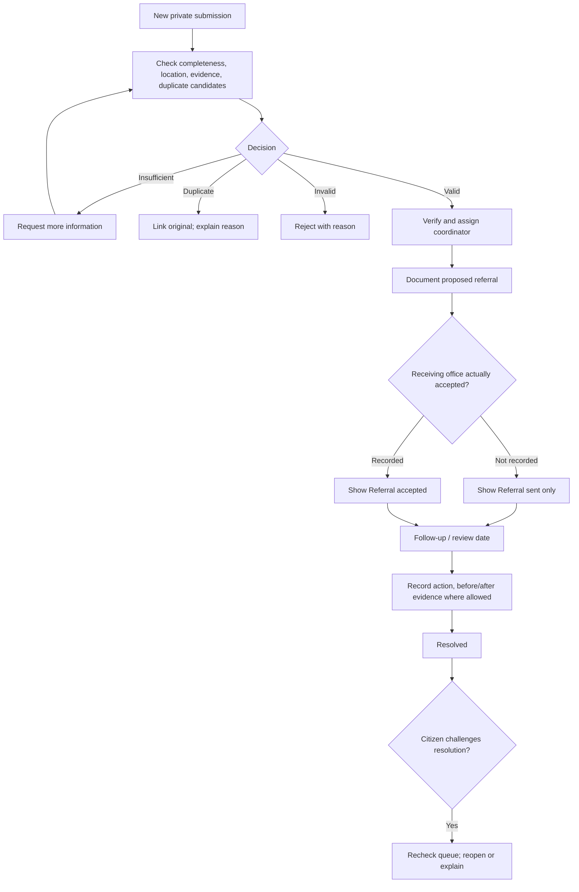
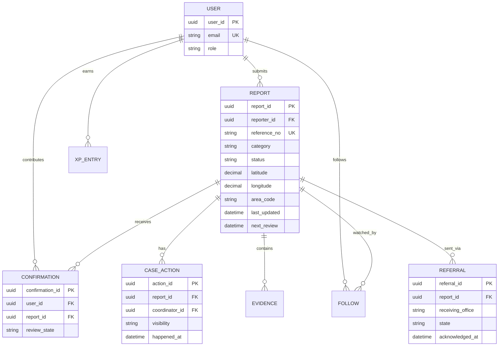
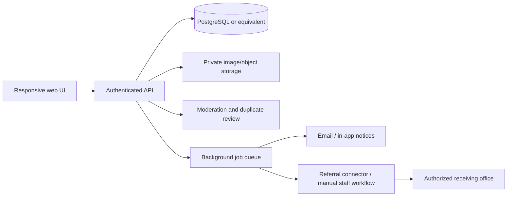

# SIDEQUEST · Project blueprint

## Problem, target users, objective

**Problem to validate:** In the Taft–Vito Cruz area, everyday issues affecting shared public spaces may be tolerated, underreported or repeatedly raised without consistent location-specific records, consolidated evidence or clear follow-up history. This is a working hypothesis, not a proven statistical claim.

**Primary users:** Students, residents, local workers, pedestrians and commuters who use public spaces in the selected Taft–Vito Cruz pilot area. **Secondary users:** A *proposed* authorized coordinator who reviews and refers reports. No government office is presently connected to the demo.

**Objective:** Design a citizen reporting experience that helps people recognize existing issues, provide valid new reports, contribute useful evidence, and understand what action has or has not been recorded. The program's game mechanics are secondary to case quality and accountability.

**Scope:** Non-emergency, location-specific accessibility and mobility, sanitation, infrastructure, and public transport access concerns. Excludes emergencies, private personal disputes, criminal allegations, harassment reports and confidential disciplinary/health complaints. Proposed pilot borders must be confirmed with an authorized partner before real launch.

## The four required wireframe/pitch pages

| Page | Citizen/coordinator goal | Deliberate UX choice | Mobile adaptation |
| --- | --- | --- | --- |
| Home | Discover existing issues and start reporting | Public entry, map preview, one clear Report action, process explanation and resolved-case history | Place main action ahead of secondary content |
| Report and Evidence | Submit adequate and accurate case data | Category examples, duplicate suggestions, location pin, evidence preview, draft and review receipt | One-column fields; large touch targets; pin and duplicates before Submit |
| Track Status/Details | Learn current status, coordinator, referral and next action | Plain-language status, case timeline, follow/unread updates, appeal/recheck, exports | Put current status/next action before full history |
| Miscellaneous: Coordinator operations | Review, verify, assign, update, and explain cases | Distinct dashboard, queues, prioritized review, audit notes, CSV & analytics | Condensed cards and control grouping |

Optional profile/rewards and map discovery are supporting sections, not replacements for the required four presentation pages.

## User flow (citizen)

## Proposed coordinator flow

**Crucial distinction:** In the browser demo the coordinator records referral states; a real office is not notified and its acceptance is not confirmed.

## User stories and acceptance criteria

| User | Story | Acceptance criterion |
| --- | --- | --- |
| Visitor | As a first-time visitor, I want to understand how reports are handled before registering | Home explains Report → Review → Refer → Track → Confirm; guest can browse |
| Citizen | As a citizen, I want to avoid repeat complaints | Related existing cases appear before final submission, with a confirm option |
| Citizen | As a citizen, I want to correct information before submitting | Review screen shows category, location, date, description, evidence and pin |
| Reporter | As a reporter, I want my pending issue kept private | Pending case appears only to reporter and demo coordinator; not in public feed |
| Citizen | As a follower, I want to know when a case changed | Followed cases appear in My Activity with an unread marker until opened |
| Coordinator | As a coordinator, I want an audit trail | Action notes, status, actor and dates append to case history |
| Coordinator | As a coordinator, I want to separate internal notes from public case history | Internal note records do not render in public tracking |
| Community explorer | As a contributor, I want recognized contributions | XP awarded at most once for a verified useful action; cosmetic unlock at milestones |

## Proposed normalized data model (for a future database)

**Additional tables:** `attachments` (file path/consent/scan state), `reward_entries` (idempotent user/source ID), `account_sessions`, `area_boundaries`, `private_notes`, `notification_events`, `badges`, `referral_receipts`.

## Logical architecture for a real pilot

**Present architecture:** HTML + CSS + JavaScript with local browser storage and illustrative status simulation. It does not contain the database/API shown above. Exported PDF summaries and CSVs are client-side demo files, not official agency records.

## Distinction from existing feedback services

The product's **proposal** is not merely “submit a complaint.” Its differentiators are a compact area-scoped map, discovery/confirmation of existing issues, visible review versus acceptance status, case follow-ups, privacy-aware reporting, and optional digital recognition. Similar concepts exist in civic systems already, so originality should not be asserted without competitive research.

## Evidence required before funding

1. Interview 8–12 people who regularly use Taft. Ask about reporting experience, obstacles and usefulness without rewards.
2. Compare existing city/barangay reporting channels and establish where SIDEQUEST would add or duplicate work.
3. Confirm the authority responsible for each category, escalation route, referral acknowledgement, and availability of coordinator staff.
4. Conduct moderated usability tests with at least one less technically experienced user, one phone user and one coordinator-like reviewer.
5. Keep pilot data and demo data separate. Measure success rather than claiming the prototype already reduces response time.
